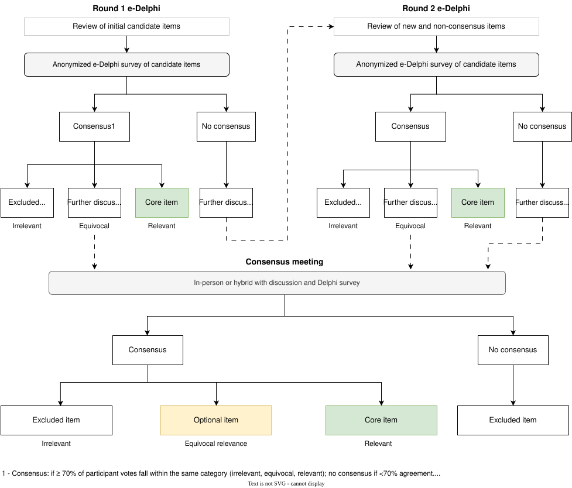

::: justify-text
A Delphi technique will be used to develop an internationally accepted evaluation framework for public health environmental surveillance. The Delphi method is an iterative multi-round approach that uses a series of sequential surveys, interspersed by controlled feedback, to elicit consensus among a group of individuals while maintaining anonymity [@shang2023; @niederberger2020]. An electronic Delphi (e-Delphi) method will be used to overcome geographic barriers and allow us to engage panellists internationally across various time zones.

The study protocol is published in [PLOS ONE](https://journals.plos.org/plosone/article?id=10.1371/journal.pone.0310342). The preprint is also available on [medRxiv](https://www.medrxiv.org/content/10.1101/2024.09.01.24312901v1).

## Recruitment of panellists

We will recruit a multinational, multidisciplinary panel of wastewater-based surveillance experts, knowledge users, and engaged members of the public to complete the e-Delphi survey. Panellists will be selected to capture the multiple perspectives of those that influence the design, implementation, evaluation, use, and reporting of wastewater surveillance activities, including the following subdisciplines groups: public health, infectious disease, epidemiology; environmental and physical sciences; mathematical sciences; social sciences; and communication, knowledge translation and exchange.

We will aim to recruit at least 50 panellists, preferably with at least 8 to 10 people per discipline subgroup. Registration opens about four weeks before Round 1, and recruitment continues during both rounds. Panellists complete a short screening questionnaire and then receive an anonymous link to the survey. The study working group will monitor the distribution of registered panellists based on their demographic information and will try to distribute appropriately across discipline subgroups and other demographic markers.

### Eligibility criteria for e-Delphi survey panellists

::: {.table-striped}
```{r table-eligibility-criteria, echo=FALSE, warning=FALSE}

# Load the gt package
library(gt)

# Create a data frame with your data
data <- data.frame(
  Discipline = c("Public health, infectious disease, epidemiology <br><br>Environmental and physical science <br><br>Mathematical sciences <br><br>Social sciences <br><br>Communication, knowledge translation and Exchange", 
    "Knowledge users", 
    "Engaged public"
  ),
  Inclusion_Criteria = c(
    "An adult^*1*^ who is proficient in English and has a graduate degree in one of the listed specializations^*2*^, or ≥ 3 years of professional experience, or ≥ 2 peer-reviewed publications relating to wastewater surveillance.",
    "An adult^*1*^ who is proficient in English and who is a professional who does not have specialized training or qualifications in wastewater-based surveillance, but who uses surveillance to inform policy and action in their workplace.",
    "An adult^*1*^ who is proficient in English and has relevant lived experience."
  )
)

# Generate the table using gt
gt(data, id = "delphi_table") %>%
   fmt_markdown() %>%
  cols_width(Discipline ~ "30%") %>%
    cols_label(
    Discipline = "Discipline subgroup", 
    Inclusion_Criteria = "Inclusion criteria"
  ) %>%
 tab_source_note(source_note = md(
    c("^*1*^ Adult: ≥ 18 years of age.",
      "^*2*^ The list of specializations associated with each discipline can be found in the S2 Table of the study protocol once published.")
  ))

```
:::

**Definitions**

*Professional experience:* Paid employment or professional practice in a listed specialization (current or former). *Graduate or professional degree:* Master or PhD in a listed discipline/specialization.

## Procedure

We will conduct a two-round e-Delphi survey to generate consensus on evaluation criteria (Figure 2). Summaries of Round 1 will be compiled for the subsequent round. Custom survey pathways will be generated for each stakeholder group (i.e., panellists from different stakeholder groups will be shown a different collection of candidate items). Within each custom stakeholder survey pathway, panellists will also have the option to skip items or self-declare that they are not qualified to assess certain candidate items.

### Round 1

Panellists will rate each candidate item shown to them in their expertise pathway on whether it should be included in an evaluation framework, using a 7-point Likert scale. Candidate items are generated from scoping review results and consultation with the study executive group. Free-text boxes will be included for panellists to provide feedback or suggest new candidate items for the next round. Items that reach consensus in Round 1 will not be re-rated in Round 2.

Round 1 will be open for about five weeks, take about an hour to complete, and include two email reminders.

### Round 2

Regardless of whether they participated in the previous round, panellists will be invited to participate in Round 2 of the e-Delphi survey. All panellists will be invited to rate new items and re-rate previous items that did not reach consensus. Items in Round 2 will be rated across four rating properties (see below). When re-rating their level of agreement, panellists will be presented with their previous round scores alongside the aggregate group results. Anonymous feedback from Round 1 will also be compiled and presented during Round 2.  Any newly suggested items during Round 2 will be deliberated on during the consensus meeting.

### Defining consensus

In Round 2, candidate items will be assessed on the following four rating properties: (1) relevance and practical utility; (2) scientific rigor, validity and reliability; (3) feasibility, adaptability and resource implications; and (4) equity, inclusiveness, and mitigation of bias. 

A 7-point Likert scale (1 = highly irrelevant to 7 = highly relevant) will be used to rate each property. A summary score for each candidate item will be created by calculating the median of the four property ratings. In Round 1, the single inclusion rating is used directly. Panellist ratings will then be categorised as excluded item (irrelevant: 1–2), further discussion (equivocal: 3–5), or core item (relevant: 6–7). Consensus for each item is defined as ≥ 70% of the panellist votes falling within the same category (1–2, 3–5, or 6–7). 

The approach to use a 7-point fully-labeled Likert scale – a higher number of categories compared to many studies – is informed by the consideration that panellists are professionals and engaged members of the public with good cognitive skills; therefore, more categories and labels will be more discriminating and reproducible [@diamond2014; @belton2019; @weijters2010; @lange2020]. The ≥ 70% consensus cut-off – a lower cut-off compared to many studies – is informed by the rapidly evolving nature of environmental surveillance for public health and the wide range of disciplines invited to the panel; therefore, a high level of agreement may not occur [@diamond2014; @belton2019; @weijters2010; @lange2020].

{fig-align="center" width=100%}
[**Figure 2.** e-Delphi consensus process for the Public Health Environmental Surveillance Evaluation Framework (PHES-EF)]{.caption}

## Timeline

<!-- To update: move the .current class (and the "Now" badge) to the active stage. Phase classes: .phase-prep, .phase-delphi, .phase-consensus, .phase-dissemination -->

:::::: timeline
::::: {.timeline-item .phase-prep .current}
[Fall 2026]{.timeline-date}

:::: timeline-content
[Preparing the survey]{.timeline-title} [Now]{.timeline-now}

Finalizing the list of candidate items, then building and piloting the e-Delphi survey.
::::
:::::

::::: {.timeline-item .phase-delphi}
[January 2027]{.timeline-date}

:::: timeline-content
[Panellist registration opens]{.timeline-title}

Panellists complete a short screening questionnaire. Recruitment continues during both rounds.
::::
:::::

::::: {.timeline-item .phase-delphi}
[March 2027]{.timeline-date}

:::: timeline-content
[Round 1]{.timeline-title}

Rate each candidate item for inclusion and suggest new items. Open for about five weeks; takes about an hour.
::::
:::::

::::: {.timeline-item .phase-delphi}
[April to May 2027]{.timeline-date}

:::: timeline-content
[Round 2]{.timeline-title}

Rate new items and re-rate items without consensus across four rating properties, with group results from Round 1.
::::
:::::

::::: {.timeline-item .phase-consensus}
[Summer 2027]{.timeline-date}

:::: timeline-content
[Analysis]{.timeline-title}

Results are analysed and a preliminary framework is prepared.
::::
:::::

::::: {.timeline-item .phase-consensus}
[Sept. or Oct. 2027]{.timeline-date}

:::: timeline-content
[Consensus meeting]{.timeline-title}

A hybrid or virtual meeting to agree on the final list of items and the dissemination plan.
::::
:::::

::::: {.timeline-item .phase-dissemination}
[Late 2027]{.timeline-date}

:::: timeline-content
[Framework and manuscript]{.timeline-title}

Preprint on OSF, then submission to an open-access journal under a CC BY-SA 4.0 licence.
::::
:::::
::::::

::: timeline-legend
[Preparation]{.legend-item .phase-prep} [e-Delphi survey]{.legend-item .phase-delphi} [Consensus]{.legend-item .phase-consensus} [Dissemination]{.legend-item .phase-dissemination}
:::

[Dates are targets and may change.]{.timeline-note}

## References

::: {#refs}
:::
:::
